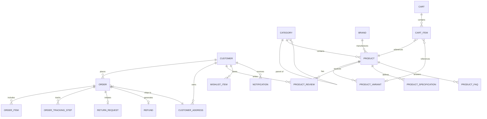
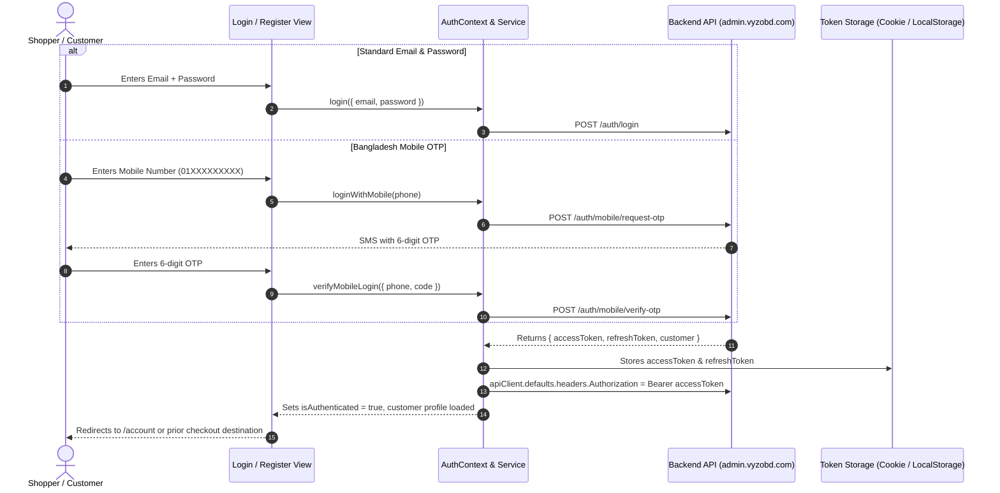

# Architectural Analysis & System Overview: Vyzobd Storefront (Velmora Beauty)

**Document Type:** Senior Software Architect Technical Audit  
**Target Repository:** `velmora-beauty-front`  
**Framework:** Next.js 16+ App Router, React 19, TypeScript  
**API Target:** `https://admin.vyzobd.com/api/storefront/v1`  
**Date:** October 2026  

---

## 1. Project Overview

### What is this project?
The `velmora-beauty-front` project (branded as **Vyzobd Storefront** / **Velmora Beauty**) is a headless, production-oriented single-vendor e-commerce web application. Built on **Next.js 16 App Router** with **React 19 Server and Client Components**, it acts as the high-performance customer-facing digital storefront decoupled from the administration and ERP backend.

### What problem does it solve?
1. **Separation of Concerns:** Traditional monolithic e-commerce platforms tightly couple business logic, database management, and UI rendering. This storefront offloads presentation and customer journeys to a decoupled frontend, eliminating performance bottlenecks.
2. **Omnichannel Customer Experience:** Delivers full-catalog searching, faceted filtering, real-time cart calculations, promotional deals, multi-step checkout with localized payment methods (Cash on Delivery, SSLCommerz, Mobile Wallets like bKash/Nagad), dynamic SEO metadata generation, and post-purchase order tracking.
3. **Resilience against Backend Variance:** Ingests dynamic, polymorphic payloads from a Laravel/REST API backend (`https://admin.vyzobd.com/api/storefront/v1`) and runs them through a defensive normalization pipeline to prevent UI runtime crashes (`TypeError`) from null, missing, or malformed data.

### Who uses it?
- **End-Consumers (Shoppers):** Browse catalogs, search products, filter by brand/category/price, add items to cart/wishlist, read verified reviews, submit product ratings, execute checkouts, and track shipment lifecycles.
- **Registered Customers:** Access account dashboards, manage multiple delivery addresses, monitor order history, request returns/exchanges, and track refund statuses.
- **Search Engine Crawlers & Social Bots:** Googlebot, Bingbot, Facebook, and Twitter crawlers ingest dynamically generated Server-Side Rendered (SSR) OpenGraph tags, JSON-LD structured data (Product, Organization, BreadcrumbList), XML sitemaps, and robots configurations.

---

## 2. Tech Stack

| Layer | Technology | Details / Notes |
| :--- | :--- | :--- |
| **Language** | **TypeScript 5.8+** | Strict mode typing across domain models, API schemas, and UI props |
| **Core Framework** | **Next.js 16+ (App Router)** | Hybrid SSR/SSG/Client components, dynamic routing, metadata API |
| **UI Framework** | **React 19** (`^19.0.1`) | React 19 Server Components, modern hooks, and hydration optimizations |
| **Styling & Design System** | **Tailwind CSS v4** (`^4.1.14`) | Tailwind v4 PostCSS engine, custom CSS variables, responsive design |
| **Icons & Visuals** | **Lucide React** (`^0.546.0`) | Feather-derived SVG icon system |
| **Animations & Effects** | **Motion** (`^12.23.24`) & **canvas-confetti** | Framer Motion animations for drawers, modals, banners, confetti on order success |
| **Form Handling & Validation** | **React Hook Form 7** & **Zod 4** | Schema-driven form validation for Auth, Address, Checkout, and Reviews |
| **Data Fetching & Cache** | **TanStack Query v5** (`@tanstack/react-query`) | Client-side cache synchronization, deduplication, and stale-time management |
| **HTTP Client** | **Axios 1.19+** | Centralized client with custom request deduplication, interceptors, and JWT token auto-refresh |
| **Sanitization & Parsing** | **isomorphic-dompurify** & **html-react-parser** | XSS prevention for user-generated content and CMS rich-text descriptions |
| **Analytics & Telemetry** | **GA4 & Google Tag Manager** | Enhanced Ecommerce telemetry (`view_item`, `add_to_cart`, `begin_checkout`, `purchase`) |
| **AI Integration** | **@google/genai** (`^2.4.0`) | Gemini API integration capabilities |
| **Database** | *Decoupled / External REST API* | No internal database/ORM in this repository; consumes backend at `admin.vyzobd.com` |
| **Tooling & Build** | **PostCSS, Autoprefixer, tsx, Node.js** | Production bundle creation and dynamic asset optimization |

---

## 3. Folder Structure

```text
velmora-beauty-front/
├── app/                              # Next.js App Router root defining all file-based routes & layouts
│   ├── account/                      # Authenticated customer portal routes
│   │   ├── activity/page.tsx         # Account security & login history
│   │   ├── addresses/page.tsx        # Customer address book management
│   │   ├── notifications/page.tsx    # Customer notifications & alerts
│   │   ├── orders/                   # Order management
│   │   │   ├── [id]/                 # Single order details & timeline
│   │   │   │   ├── tracking/page.tsx # Shipment tracking view
│   │   │   │   └── page.tsx          # Order details page
│   │   │   └── page.tsx              # Order history list
│   │   ├── profile/page.tsx          # Profile details & password update
│   │   ├── refunds/page.tsx          # Refund status page
│   │   ├── returns/page.tsx          # Product return requests
│   │   ├── wishlist/page.tsx         # Saved items list
│   │   └── page.tsx                  # Account dashboard overview
│   ├── blog/                         # Blog & editorial content
│   │   ├── [slug]/page.tsx           # Single article reader
│   │   └── page.tsx                  # Blog articles index
│   ├── brands/                       # Partner brands directory
│   │   ├── [slug]/page.tsx           # Single brand catalog page
│   │   └── page.tsx                  # Brand listing directory
│   ├── cart/page.tsx                 # Full-page shopping cart
│   ├── categories/                   # Category directory
│   │   ├── [slug]/page.tsx           # Category-specific catalog
│   │   └── page.tsx                  # All categories directory
│   ├── checkout/page.tsx             # Multi-step checkout flow
│   ├── faq/page.tsx                  # Knowledge base & FAQ accordion
│   ├── forgot-password/page.tsx      # Password recovery request
│   ├── login/page.tsx                # Customer authentication (Email & Mobile OTP)
│   ├── order-confirmation/page.tsx   # Post-purchase receipt & tracking landing
│   ├── pages/[slug]/page.tsx         # Dynamic CMS pages (Privacy, Terms, About, Contact)
│   ├── products/                     # Product catalog & details
│   │   ├── [slug]/page.tsx           # Product detail page (PDP) with gallery & variants
│   │   └── page.tsx                  # Main product catalog
│   ├── register/page.tsx             # New customer registration
│   ├── reset-password/page.tsx       # Password reset token confirmation
│   ├── search/page.tsx               # Full-text faceted search view
│   ├── shop/page.tsx                 # Shop catalog grid
│   ├── wishlist/page.tsx             # Customer wishlist page
│   ├── global-error.tsx              # Global error boundary for uncaught exceptions
│   ├── layout.tsx                    # Root HTML layout with providers, Header, Footer & Modals
│   ├── loading.tsx                   # Root suspense loading fallback
│   ├── not-found.tsx                 # Custom 404 page
│   ├── page.tsx                      # Flagship homepage (Phase 4 design)
│   ├── robots.ts                     # Dynamic robots.txt generation
│   └── sitemap.ts                    # Dynamic XML sitemap generator
│
├── src/                              # Core application source code
│   ├── components/                   # Modular React UI components
│   │   ├── account/                  # Dashboard, orders, profile, address components
│   │   ├── auth/                     # Login, register, forgot-password forms
│   │   ├── cart/                     # Cart drawer, items, checkout forms, summaries
│   │   ├── checkout/                 # Address forms, payment steps, gateway simulation
│   │   ├── common/                   # Header, Footer, Modals, Toasts, MegaMenu, SmartImage
│   │   ├── content/                  # CMS pages, blog readers, rich text parser
│   │   ├── home/                     # Phase 4 Hero, Promos, Featured categories/products
│   │   ├── product/                  # PDP gallery, variant pickers, reviews, specs
│   │   ├── search/                   # Search bar, filter sidebar, suggestions
│   │   ├── shop/                     # Catalog views, grid layouts, brand filters
│   │   └── ui/                       # Reusable primitives (Button, Input, Modal, Badge, Drawer)
│   ├── config/                       # Application configuration
│   │   └── bannerConfig.ts           # Fallback banners and marketing configurations
│   ├── context/                      # React Context state management
│   │   ├── AuthContext.tsx           # Authentication lifecycle, tokens, customer profile
│   │   ├── SettingsContext.tsx       # Dynamic public store settings, taxes, branding
│   │   └── StorefrontContext.tsx     # Global UI state, cart drawer, modals, legacy view bridge
│   ├── hooks/                        # Custom React hooks
│   │   └── useCart.ts                # TanStack Query wrapper for cart mutations & queries
│   ├── lib/                          # Core infrastructure libraries
│   │   ├── api.ts                    # Central Axios client, interceptors, normalizers
│   │   ├── ga4.ts                    # Google Analytics 4 tracking utilities
│   │   ├── searchUtils.ts            # Client-side filtering and facet algorithms
│   │   └── seo.ts                    # SSR metadata generators and JSON-LD builders
│   ├── providers/                    # Top-level client providers
│   │   ├── AnalyticsProvider.tsx     # Initializes GA4/GTM scripts and route change listeners
│   │   └── StorefrontProviders.tsx   # Composes QueryClient, Settings, Storefront, and Auth
│   ├── services/                     # API service layer interfacing with REST endpoints
│   │   ├── addressService.ts         # Customer address book CRUD operations
│   │   ├── analyticsService.ts       # Analytics credentials & configuration fetching
│   │   ├── apiClient.ts              # Export alias for the central apiClient
│   │   ├── authService.ts            # Login, register, OTP, password recovery, session refresh
│   │   ├── brandService.ts           # Brands retrieval and filtering
│   │   ├── cartService.ts            # Cart retrieval, add/update/remove line items
│   │   ├── categoryService.ts        # Category trees and hierarchical relationships
│   │   ├── checkoutService.ts        # Checkout sessions, coupons, order placement
│   │   ├── contentService.ts         # Banners, popups, FAQs, CMS pages, blog articles
│   │   ├── orderService.ts           # Order listings, order details, tracking
│   │   ├── paymentService.ts         # Payment gateway initiation and verification
│   │   ├── productService.ts         # Products retrieval, slugs, featured collections
│   │   ├── refundService.ts          # Customer refund tracking
│   │   ├── returnService.ts          # Customer return requests
│   │   ├── reviewService.ts          # Product reviews, eligibility, rating submission
│   │   ├── searchService.ts          # Search queries, faceted counts, auto-suggestions
│   │   ├── settingsService.ts        # Public storefront settings (branding, currency, shipping)
│   │   ├── storefrontApi.ts          # Consolidated aggregator facade for all services
│   │   ├── uploadService.ts          # Media upload (Cloudinary and server endpoints)
│   │   └── wishlistService.ts        # Wishlist persistence and synchronization
│   ├── types/                        # TypeScript type definitions and contracts
│   │   ├── auth.ts                   # Customer, Auth payloads, Zod form schemas
│   │   ├── checkout.ts               # Checkout form structures, payment methods
│   │   ├── feedback.ts               # Toast notifications and modal feedback types
│   │   └── storefront.ts             # Core domain models (Product, Cart, Order, Settings)
│   ├── utils/                        # General helper utilities
│   │   ├── analytics.ts              # GA4 Enhanced Ecommerce event dispatchers
│   │   ├── categoryHierarchy.ts      # Tree structure builder for parent/child categories
│   │   ├── feedback.ts               # Toast message builders and error message sanitizers
│   │   ├── formatters.ts             # Currency and date formatting helpers
│   │   ├── imageUtils.ts             # Cloudinary image transformations and fallbacks
│   │   └── seo.ts                    # Structured JSON-LD generator for products & breadcrumbs
│   └── index.css                     # Global Tailwind CSS imports, color tokens, font declarations
│
├── docs/                             # Architecture specs, forensic audits, and developer guides
├── public/                           # Static assets (favicons, SVGs, brand logos, banners)
├── .env.example                      # Environment variable template
├── metadata.json                     # Storefront platform metadata
├── next.config.mjs                   # Next.js configuration (remote image hostnames, strict mode)
├── package.json                      # Project dependencies, scripts, and engine metadata
├── postcss.config.mjs                # PostCSS plugin pipeline for Tailwind CSS
├── README.md                         # Project documentation and developer instructions
└── tsconfig.json                     # TypeScript compiler options
```

---

## 4. Entry Points

### How does the app start?
1. **Server Boot (`next dev` / `next start`):**
   - The application starts via Next.js CLI defined in `package.json` (`next dev -p 3000 --hostname 0.0.0.0`).
   - `next.config.mjs` configures remote image domains (`res.cloudinary.com`, `images.unsplash.com`, `picsum.photos`, etc.) and sets `reactStrictMode: true`.

2. **Root Entry Point (`app/layout.tsx`):**
   - **SSR Pre-fetching:** Executes server-side `generateMetadata()` using `getHomepageMetadata()` and fetches initial analytics settings (`storefrontApi.getAnalyticsConfig()`).
   - **Provider Tree Mounting (`StorefrontProviders.tsx`):** Wraps the entire application in a hierarchical context:
     1. `QueryClientProvider` (TanStack React Query client with 1-min stale time)
     2. `SettingsProvider` (loads public store branding, shipping thresholds, tax rules)
     3. `StorefrontProvider` (handles active UI modals, cart drawer, toast notifications)
     4. `AuthProvider` (validates customer token, restores `/auth/me` session)
   - **Global Shell:** Renders global singletons: `<Header />`, `<main>{children}</main>`, `<Footer />`, `<CartDrawer />`, `<QuickViewModal />`, `<AuthModal />`, `<ToastContainer />`, and `<PromotionalPopup />`.

3. **Homepage Route (`app/page.tsx`):**
   - Serves as the landing route (`/`).
   - Generates dynamic SEO OpenGraph tags and structured data.
   - Mounts `src/components/home/HomePage.tsx` (Phase 4 design: Hero editorial banner, Trust features, Category grid, Product tabs, Deal of the Day, Brand showcase, and Blog editorial).

---

## 5. Database & Domain Models

### Architecture Note on Database
This repository is a **decoupled headless frontend**. It does not own a local SQL/NoSQL database, migration scripts, or an ORM like Prisma or Eloquent. Instead, the persistence layer is hosted remotely at `https://admin.vyzobd.com`. The frontend maintains strict TypeScript domain models that mirror the backend relational database entities:

### Relational Domain Model Schema



### Core Entities & Fields
1. **Product (`Product`):**
   - `id`, `slug`, `name`, `brand`, `brandId`, `category`, `categoryId`, `price`, `compareAtPrice`, `discountPercent`, `stock`, `rating`, `reviewCount`, `images[]`, `description`, `features[]`, `isFeatured`, `isDealOfDay`.
2. **ProductVariant (`ProductVariant`):**
   - `id`, `name` (e.g. "Color: Ruby Red", "Size: 100ml"), `sku`, `price`, `compareAtPrice`, `stock`, `image`, `colorHex`.
3. **Category (`Category`):**
   - `id`, `slug`, `name`, `description`, `image`, `itemCount`, `parentId`, `subcategories[]`.
4. **Brand (`Brand`):**
   - `id`, `slug`, `name`, `logo`, `description`, `itemCount`.
5. **Cart & CartItem (`Cart`, `CartItem`):**
   - `Cart`: `items[]`, `subtotal`, `discount`, `appliedCoupon`, `shippingFee`, `estimatedTax`, `total`.
   - `CartItem`: `id`, `productId`, `product`, `selectedVariant`, `quantity`, `unitPrice`, `totalPrice`.
6. **Order (`Order`):**
   - `id` (e.g. "ORD-94821"), `orderNumber`, `createdAt`, `status` (Placed, Processing, Shipped, Out for Delivery, Delivered, Cancelled), `items[]`, `shippingAddress`, `shippingMethod`, `paymentMethod`, `subtotal`, `shippingFee`, `tax`, `totalAmount`, `trackingNumber`, `trackingSteps[]`.
7. **Customer / UserProfile (`Customer`):**
   - `id`, `firstName`, `lastName`, `fullName`, `email`, `phone`, `avatar`, `emailVerified`, `phoneVerified`, `defaultAddress`.
8. **CustomerAddress (`CustomerAddress`):**
   - `id`, `customerId`, `fullName`, `phone`, `address1`, `address2`, `city`, `state`, `postalCode`, `country`, `isDefault`.
9. **ProductReview (`ProductReview`):**
   - `id`, `author`, `rating` (1-5), `title`, `comment`, `verifiedPurchase`, `images[]`, `adminResponse`, `date`.
10. **PublicSettings (`PublicSettings`):**
    - `branding` (logo, favicon, siteName, colors), `shipping` (freeShippingThreshold, insideDhakaCharge, outsideDhakaCharge), `tax` (taxPercentage, isTaxInclusive), `seo`, `contact`.

---

## 6. Authentication & Roles

### Authentication Mechanism
The application supports a dual-path customer authentication architecture:



### Silent Token Refresh (401 Interceptor Loop)
- Requests failing with `401 Unauthorized` are intercepted in `src/lib/api.ts`.
- The failed request is enqueued into `failedQueue`.
- The client dispatches `POST /auth/refresh-token` (with fallback to `POST /auth/refresh`) using the stored `refreshToken`.
- If successful, the new access token is stored, the Axios instance defaults are updated, and all queued requests are retried seamlessly.
- If refresh fails, tokens are purged, `customer:session_expired` is dispatched, and the user is redirected to `/login?session_expired=true`.

### User Roles
In this storefront application, permissions are partitioned into two customer states:
1. **Guest Shopper:**
   - Identified by an anonymous `x-session-id` or `X-Cart-Session-Id` header (stored in `localStorage`).
   - Allowed to browse products, read reviews, create a guest cart, apply coupons, and perform guest checkout.
2. **Authenticated Customer:**
   - Identified by JWT Bearer token.
   - Permitted access to protected `/account/*` routes, address book CRUD, order history, live tracking, writing reviews, and submitting return requests.
   *(Administrative / Staff roles exist exclusively on the separate `admin.vyzobd.com` backend).*

---

## 7. Main Features & Step-by-Step Flows

### Flow 1: Product Discovery, Filtering & Quick View
1. User enters query into `<Header>` search or navigates to `/shop` or `/categories/[slug]`.
2. Input is debounced; `searchService.search()` fetches matching products and faceted counts (categories, brands, price ranges, ratings).
3. Clicking an item's eye icon opens `<QuickViewModal />` allowing instant variant selection and image browsing without leaving the page.
4. Clicking the product card navigates to `/products/[slug]`, triggering dynamic SSR metadata and rendering full image zoom, product specs, FAQs, and customer reviews.

### Flow 2: Cart Management & Drawer
1. On PDP or product grid, user clicks **"Add to Cart"** with desired variant and quantity.
2. `useCart().addToCart()` sends `POST /cart/items` with `productId`, `variantId`, and `quantity` alongside `x-session-id`.
3. Backend responds with the updated cart; `normalizeCart()` parses items and computes `subtotal`, `discount`, and `total`.
4. Global `<CartDrawer />` slides out from the right, displaying line items, shipping threshold meter ("Add \$X more for Free Shipping"), and quick checkout button.

### Flow 3: Multi-Step Checkout & Payment
1. User navigates to `/checkout` (protected or guest mode).
2. **Step 1 - Contact Details:** Enters customer email and Bangladesh mobile number (`01XXXXXXXXX`).
3. **Step 2 - Shipping Address:** Inputs delivery address with city/district selection; calculates dynamic shipping fee (e.g. Inside Dhaka vs. Outside Dhaka based on public settings).
4. **Step 3 - Delivery Method:** Chooses Standard Delivery or Express Delivery.
5. **Step 4 - Payment Gateway:** Selects Cash on Delivery (COD), bKash/Nagad, or SSLCommerz credit/debit card.
6. **Step 5 - Order Placement:** Submits `POST /checkout/complete`. If COD, instantly redirects to `/order-confirmation?orderId=ORD-XXXX` with confetti celebration. If online gateway, launches gateway redirect or simulation before landing on payment verification.

### Flow 4: Order Tracking & Customer Post-Purchase
1. Authenticated customer visits `/account/orders`.
2. Selects an order to open `/account/orders/[id]`.
3. View displays line items, payment status, shipping address, and order milestones (`Placed` -> `Processing` -> `Shipped` -> `Out for Delivery` -> `Delivered`).
4. If delivered, user can click **"Write a Review"** (validated via `GET /products/:slug/reviews/eligibility`) or **"Request Return"** within the allowed policy window.

---

## 8. API & Route Directory

### Storefront HTTP Endpoints (`admin.vyzobd.com/api/storefront/v1`)

| Domain | Method & Endpoint | Description |
| :--- | :--- | :--- |
| **Settings** | `GET /settings/public` | Fetches store branding, contact, tax rules, and delivery fees |
| **Analytics** | `GET /settings/analytics` | Retrieves Google Analytics 4 Measurement ID and GTM container ID |
| **Content** | `GET /banners`, `GET /popups`, `GET /faqs` | Fetches homepage hero/promo banners, promotional popups, and FAQs |
| **CMS** | `GET /pages/:slug`, `GET /blog`, `GET /blog/:slug` | Fetches dynamic policy pages (terms, privacy, shipping) and blog posts |
| **Catalog** | `GET /products`, `GET /products/:slug` | Lists filtered products and single product details by slug |
| **Taxonomy** | `GET /categories`, `GET /brands` | Retrieves category hierarchy and partner brand listings |
| **Search** | `GET /search`, `GET /search/facets` | Full-text product search with dynamic aggregation facets |
| **Cart** | `GET /cart`, `POST /cart/items` | Reads active cart and adds items (tied to Bearer token or Session ID) |
| **Cart Line** | `PUT /cart/items/:id`, `DELETE /cart/items/:id` | Updates item quantity or deletes item from cart |
| **Checkout** | `GET /checkout/session`, `POST /checkout/coupon` | Initializes checkout data and validates promo coupon codes |
| **Orders** | `POST /checkout/complete` or `POST /orders` | Places final purchase order |
| **Payment** | `POST /payment/initiate`, `POST /payment/verify` | Launches payment transaction and verifies payment callback |
| **Auth** | `POST /auth/login`, `POST /auth/register` | Standard email/password customer authentication |
| **Mobile OTP** | `POST /auth/mobile/request-otp`, `verify-otp` | Bangladesh mobile phone OTP login/registration |
| **Customer** | `GET /auth/me`, `PATCH /customer/profile` | Fetches current user session profile and updates details |
| **Addresses** | `GET /customer/addresses`, `POST /customer/addresses` | Customer address book CRUD operations |
| **Reviews** | `GET /products/:slug/reviews`, `POST /products/:slug/reviews` | Fetches approved reviews and submits new ratings/reviews |
| **Wishlist** | `GET /wishlist`, `POST /wishlist/:id` | Reads customer wishlist and toggles saved items |

---

## 9. Top 10 Most Important Files to Read First

| # | File Path | Why It Is Critical |
| :---: | :--- | :--- |
| **1** | [`src/lib/api.ts`](file:///c:/Users/ome/Desktop/velmora-beauty-front/src/lib/api.ts) | **The Core Network Engine:** Central Axios instance, request/response interceptors, automatic 401 token refresh queue, and defensive normalizers (`normalizeProduct`, `normalizeCart`). |
| **2** | [`app/layout.tsx`](file:///c:/Users/ome/Desktop/velmora-beauty-front/app/layout.tsx) | **The Application Root:** Sets up the root HTML structure, SSR metadata generation, and wraps the app with `StorefrontProviders` and global modals. |
| **3** | [`src/providers/StorefrontProviders.tsx`](file:///c:/Users/ome/Desktop/velmora-beauty-front/src/providers/StorefrontProviders.tsx) | **Global Provider Hierarchy:** Manages TanStack Query client lifecycle and orders the context tree (`Settings` -> `Storefront` -> `Auth`). |
| **4** | [`src/context/AuthContext.tsx`](file:///c:/Users/ome/Desktop/velmora-beauty-front/src/context/AuthContext.tsx) | **Customer Security & Session:** Controls authentication state, token persistence, email/password login, mobile OTP verification, and profile synchronization. |
| **5** | [`src/context/StorefrontContext.tsx`](file:///c:/Users/ome/Desktop/velmora-beauty-front/src/context/StorefrontContext.tsx) | **Global UI & Routing Bridge:** Coordinates cart drawer state, quick view modals, wishlist, toasts, and translates legacy view transitions to Next.js routes. |
| **6** | [`src/types/storefront.ts`](file:///c:/Users/ome/Desktop/velmora-beauty-front/src/types/storefront.ts) | **Domain Type Definitions:** Defines the contracts for `Product`, `ProductVariant`, `Cart`, `Order`, `Category`, `Brand`, and `PublicSettings`. |
| **7** | [`src/services/storefrontApi.ts`](file:///c:/Users/ome/Desktop/velmora-beauty-front/src/services/storefrontApi.ts) | **Facade API Client:** Unifies all domain services (products, cart, checkout, content, reviews) into a single callable API client for UI consumption. |
| **8** | [`src/components/home/HomePage.tsx`](file:///c:/Users/ome/Desktop/velmora-beauty-front/src/components/home/HomePage.tsx) | **Flagship Presentation View:** Canonical Phase 4 homepage layout assembling the editorial Hero, Categories, Featured Products, Special Offers, and Brands. |
| **9** | [`src/components/cart/CheckoutPage.tsx`](file:///c:/Users/ome/Desktop/velmora-beauty-front/src/components/cart/CheckoutPage.tsx) | **E-Commerce Conversion Core:** Multi-tier checkout handling contact information, addresses, shipping selection, coupon codes, and payment execution. |
| **10** | [`src/components/product/ProductDetailPage.tsx`](file:///c:/Users/ome/Desktop/velmora-beauty-front/src/components/product/ProductDetailPage.tsx) | **Product Detail Experience:** Renders variant selection matrices, image zoom gallery, real-time stock availability, specs, and review submissions. |

---

## 10. Missing / Weak Points & Architectural Vulnerabilities

As part of a rigorous Senior Architectural review, the following critical bugs, incomplete modules, and structural discrepancies were identified:

### 🚨 Critical / Build-Breaking Issues
1. **Missing `src/lib/tokenStorage.ts` Module:**
   - Multiple core files (`src/lib/api.ts`, `src/context/AuthContext.tsx`, `src/context/StorefrontContext.tsx`, `src/services/authService.ts`, `src/services/cartService.ts`, `src/services/orderService.ts`, `src/services/reviewService.ts`) import `{ tokenStorage } from '../lib/tokenStorage'`.
   - **Impact:** The file does not exist on disk. Any build or compile step (`tsc --noEmit` or `next build`) fails immediately with `Cannot find module '../lib/tokenStorage'`.
2. **Missing `src/services/customerService.ts` Module:**
   - Imported by `src/services/storefrontApi.ts`, `src/context/AuthContext.tsx`, `src/components/common/Header.tsx`, `AccountDashboard.tsx`, `AccountLayout.tsx`, `OrdersPage.tsx`, `OrderDetailsPage.tsx`, `ProfilePage.tsx`, and `NotificationsPage.tsx`.
   - **Impact:** The entire customer account section (dashboard stats, order history, notification status, address updates, change password) is disconnected and unbuildable.
3. **Missing `src/services/couponService.ts` Module:**
   - Imported by `src/services/storefrontApi.ts` line 8.
   - **Impact:** Coupon validation and promotional discount fetching through the facade API fail.
4. **Missing `src/utils/phone.ts` Utility:**
   - Imported by `src/types/auth.ts`, `src/types/checkout.ts`, `src/services/authService.ts`, `LoginPage.tsx`, and `RegisterPage.tsx` for BD phone validation (`isValidBDPhone`, `normalizeBDPhone`, `formatBDPhoneE164`).
   - **Impact:** Authentication validation schemas cannot evaluate Bangladesh phone numbers.
5. **Missing Account Sub-Components & Pages:**
   - `app/account/refunds/page.tsx` imports non-existent `src/components/account/RefundsPage`.
   - `app/account/returns/page.tsx` imports non-existent `src/components/account/ReturnsPage`.
   - In `src/components/account/OrderDetailsPage.tsx`, child components `NotificationCard.tsx`, `OrderTrackingTimeline.tsx`, `ReturnRequestModal.tsx`, and `ReviewForm.tsx` are missing.
   - `app/layout.tsx` imports `PromotionalPopup` from `src/components/common/PromotionalPopup`, which is missing.

### ⚠️ Architecture & Configuration Inconsistencies
6. **Package Name & Version Mismatch:**
   - `package.json` names the package `"react-example"` with version `"0.0.0"`. This should be updated to `"velmora-beauty-storefront"` or `"vyzobd-storefront"`.
7. **Legacy Build Script on Windows:**
   - `package.json` contains `"clean": "rm -rf .next dist"`. On native Windows Command Prompt, `rm -rf` fails because Windows uses `rmdir /s /q` or PowerShell `Remove-Item`.
8. **Routing Paradigm Overlap (Vite SPA vs. Next.js App Router):**
   - `StorefrontContext.tsx` still maintains an extensive `AppView` state machine (`currentView`, `viewParams`, `navigateTo`) from the legacy Vite SPA implementation. While `navigateTo` now calls `router.push()`, having two parallel routing abstractions (Next.js file routes vs. React Context `currentView`) creates state synchronization risks when users use browser Back/Forward buttons.
9. **Single-Point-of-Failure API Dependency:**
   - The storefront lacks localized mock fallback mocks in production. If `admin.vyzobd.com` experiences latency or downtime, the application displays empty state placeholders rather than degraded graceful fallbacks.

---

## 11. Architect's Summary & Action Recommendations

The **Vyzobd / Velmora Beauty Storefront** features a sophisticated design system, clean Tailwind v4 styling, robust defensive data normalization, and an intuitive customer journey across catalog, cart, and checkout.

To transition this codebase into a fully deployable, production-ready state, the immediate architectural priority must be **supplying the missing service and utility dependencies** (`tokenStorage.ts`, `customerService.ts`, `couponService.ts`, `phone.ts`, `trackingStatus.ts`, and the missing account sub-components). Once these modules are implemented or restored, running `npm run lint` and `npm run build` will compile cleanly into a high-performance Next.js production artifact.
